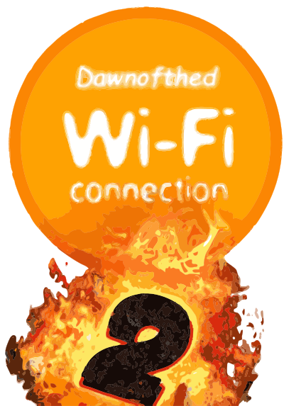

<p align="center">
  
</p>

<h1 align="center">DAWNOFTHED WFC ENHANCED VERSION</h1>

<p align="center">
  State of the Art Nintendo Wi-Fi Connection replacement server for DS and Wii games<br>
  <a href="https://github.com/WiiListZ/dwc-server-advanced/releases/latest">Releases</a> ·
  <a href="#installation">Installation</a> ·
  <a href="https://github.com/WiiListZ/dwc-server-advanced-patcher">Client patcher</a>
</p>

**Dawnofthed WFC** is an open source replacement server for the discontinued Nintendo Wi-Fi Connection (DWC), for Nintendo DS and Wii games. On top of the GameSpy/NAS server stack it adds:

- a web setup wizard;
- a moderation panel with fine-grained moderator rights;
- public player profiles with avatar, bio, live game status and stats;
- server settings you can edit in the browser;
- self-updates from GitHub releases.

It runs on Linux, Windows and macOS, as a single binary or in Docker.

The project has two parts:

| Repository | Runs on | Role |
|---|---|---|
| **Dawnofthed WFC** (this one) | Your server | Online services, website and moderation panel. It serves the patch payloads to clients and signs them. |
| **[Dawnofthed WFC-patcher](https://github.com/WiiListZ/Dawnofthed WFC-patcher)** | Wii / Dolphin | Patches games so they connect to your server, and fixes their security bugs. Fork of [WiiLink24/wfc-patcher-wii](https://github.com/WiiLink24/wfc-patcher-wii). |

Build the patcher once with your domain and copy its output into the server's `payload/` directory; see [Client patcher](#client-patcher).


> [!NOTE]
> Part of this codebase comes from **[WiiLink24/wfc-server](https://github.com/WiiLink24/wfc-server)** (WiiLink WFC), which is licensed under the GNU AGPL v3. The original authors keep the copyright on their code. This project is a derivative work under the same license; see [License and credits](#license-and-credits).

## Contents

- [Features](#features)
- [Screenshots](#screenshots)
- [Installation](#installation)
- [First-run setup](#first-run-setup)
- [Server settings](#server-settings)
- [Updates](#updates)
- [Configuration reference](#configuration-reference)
- [Web panel](#web-panel)
- [Bans and kicks](#bans-and-kicks)
- [Disabling games](#disabling-games)
- [Ending a race](#ending-a-race)
- [Profiles](#profiles)
- [Client patcher](#client-patcher)
- [Ports](#ports)
- [Project layout](#project-layout)
- [Documentation](#documentation)
- [Development](#development)
- [License and credits](#license-and-credits)

## Features

**Game services**

- NAS authentication (HTTP and HTTPS), including the Wii and DS SSL exploit certificate chains.
- GameSpy services: GPCM (login/friends), GPSP (profile search), QR2 (matchmaking), server browser, NAT negotiation, SAKE storage, gamestats, and Mario Kart Wii race results.
- Payload serving for clients patched with [dwc-server-advanced-patcher](https://github.com/WiiListZ/dwc-server-advanced-patcher) (see [Client patcher](#client-patcher) and [docs/PAYLOADS.md](docs/PAYLOADS.md)).
- Split frontend/backend processes, so the backend can restart without dropping client connections.

**Setup and operations**

- **First-run setup wizard** in the browser: database, network, HTTPS, rules and the owner account. It writes `config.yml` for you and creates the database tables on an empty database.
- **Server settings** editable in the panel by the owner, with a restart button.
- **Self-updates**: the server notices new GitHub releases. The owner installs them now (a few seconds of downtime) or schedules them for later, and the server then updates by itself.
- **Runs anywhere**: one self-contained binary for Linux (amd64, arm64, arm), Windows and macOS. The panel and the game list are built in. Also available as a Docker image, with a Linux installer that sets up a systemd service.

**Web panel**

- Built with React, Tailwind CSS and [shadcn/ui](https://ui.shadcn.com), plus TanStack Table, Recharts, cmdk and Sonner. Light and dark themes; works on phones.
- Public status page with live player counts, the most played games, a room board and the public ban list. Logged-in players can report or kick players from their own room.
- **Public profiles** at `/u/<username>`: avatar, bio, live game status (game, room, host) and stats such as matches, VR/BR and time trials. Each user can hide their stats, and the owner can turn the whole profile system off (see [Profiles](#profiles)).
- **Player-centric moderation**: click a player anywhere (rooms, lists, bans, reports, activity) to open their profile. It shows status, current room, ban history, reports and recent activity, and lets you ban, kick, message or unban them.
- Dashboard with live charts, a live event feed and the most reported players.
- Live view of every room and player, with force-join, end-race and delete-room tools.
- Report inbox to triage reports one player at a time.
- Activity timeline of every moderation and network event of the last 14 days.
- Command palette (Ctrl+K) to find any online player or room and run actions.
- Mario Kart Wii time trial leaderboards by cup and track, with ghost downloads.
- Team view where the owner edits each moderator's rights with switches.
- Each section has its own route; sections an account cannot open answer 404.

**Service controls**

- Console-based bans that cover every profile on a console, with ban history. Lifted bans are either kept as "Revoked" or deleted, as you choose.
- Per-game blocking with custom NAS return codes and payload error messages. Codes without a region letter block every region, and players already online are disconnected (see [Disabling games](#disabling-games)).
- Event reporting to the database and to Discord webhooks.

## Screenshots

| | |
|---|---|
|  **Setup wizard** — configure a new server from the browser. |  **Server folder** — choose where the server keeps its files. |
|  **Database step** — let the setup create PostgreSQL with Docker, or connect to your own. |  **Server folder in the panel** — upload certificates and payloads from the browser. |
|  **Console** — the server's terminal output, live, in the panel. |  **Docs** — every guide, readable in the panel. |
|  **Edit files** — YAML, JSON and text files with highlighting. |  **Read logs** — log levels in colour. |
|  **Finish** — review the choices, then the server starts. |  **Server** — version, updates and every setting, editable by the owner. |
|  **Install later** — the server updates itself at the chosen time. |  **Public status** — live player count, most played games and the room board. |
|  **Live** — every room and player; click one to inspect it. |  **Player profile** — status, bans, reports and activity, plus one-click actions. |
|  **Ban dialog** — duration presets, reason templates and private notes. |  **Reports** — triage inbox, one reported player at a time. |
|  **Activity** — every event of the last 14 days, filterable by type. |  **Event details** — every field of an event, with links to the player and room. |
|  **Games** — blocked games with their error codes. |  **Disable a game** — search the whole game list. |
|  **Team** — edit each moderator's rights with switches. |  **Ghosts** — Mario Kart Wii leaderboards by cup and track. |
|  **Command palette** — Ctrl+K to find players, rooms and actions. |  **Light theme** — every page follows the system theme or your choice. |
|  **Account settings** — rights, linked consoles, Open Host and preferences. |  **Error codes** — searchable list of in-game and custom error codes. |
|  **Profile** — avatar, bio, live game status and stats. |  **Edit profile** — upload an avatar, write a bio, hide your stats. |

<p align="center"></p>

## Installation

You need **PostgreSQL** (16 recommended). The included `docker-compose.yml` runs one on `127.0.0.1:5432`; its database name, user and password come from `.env` (see [.env.example](.env.example)):

```sh
docker compose up -d postgres
```

### Linux (recommended)

The installer downloads the latest release for your CPU and verifies its SHA-256 checksum. It then creates a `dwc` system user and a systemd service, and adds the global `dwc-server-advanced` command:

```sh
curl -fsSL https://raw.githubusercontent.com/WiiListZ/dwc-server-advanced/main/scripts/install-linux.sh | sudo bash
journalctl -u dwc-server-advanced -n 30 --no-pager   # shows the setup link on the first start
```

| Path | Content |
|---|---|
| `/opt/dwc-server-advanced/dwc-server-advanced` | The binary, owned by `dwc` so the updater can replace it |
| `/usr/local/bin/dwc-server-advanced` | Symlink to the binary |
| `/var/lib/dwc-server-advanced` | Data directory: `config.yml`, certificates, `payload/`, `state/`, `logs/` |
| `/etc/systemd/system/dwc-server-advanced.service` | The service ([deploy/dwc-server-advanced.service](deploy/dwc-server-advanced.service)) |

The installer accepts these environment variables:
- `DWC_VERSION=v1.2.3` installs a specific tag;
- `DWC_REPOSITORY=owner/name` installs from a fork;
- `DWC_BINARY=/path/to/binary` installs a local build;
- `DWC_NO_SERVICE=1` skips systemd.

The service can bind ports 80 and 443 without root (`CAP_NET_BIND_SERVICE`).

**Manual install**: download `dwc-server-advanced_linux_<arch>` from the [releases](https://github.com/WiiListZ/dwc-server-advanced/releases), make it executable and run it from anywhere:

```sh
chmod +x dwc-server-advanced_linux_amd64
sudo ./dwc-server-advanced_linux_amd64 --dir /srv/dwc
```

### Windows

Download `dwc-server-advanced_windows_amd64.exe` from the [releases](https://github.com/WiiListZ/dwc-server-advanced/releases) and run it from a terminal opened **as Administrator** (ports 80 and 443). Open the setup link it prints. Use `--dir C:\path\to\data` to keep the data somewhere else than the current folder.

### Docker

```sh
docker compose --profile server up -d
docker compose logs server          # shows the setup link
```

The `server` service uses `ghcr.io/wiilistz/dwc-server-advanced:latest` and stores everything in `./data`. If the image is not published yet, it builds it from the Dockerfile. In the wizard use **`postgres`** as the database host. Inside Docker the updater only notifies; update with `docker compose pull && docker compose --profile server up -d`.

### From source

```sh
go build                 # needs Go 1.24+; the web panel in api/dist is prebuilt
./dwc-server-advanced    # or dwc-server-advanced.exe
```

## First-run setup

When the data directory has no `config.yml`, the server starts the **setup wizard** instead of the game services and prints a private link:

```text
  No config.yml found: first-run setup
  Open one of these links in a browser to configure the server:
    http://192.168.1.10/setup?token=XEURXUIPITBUEEZZLJOJCJWJ
  Keep the token private: anyone with it can configure the server.
```

1. **Welcome**: server name and logging.
2. **Folder**: where the server keeps its files (`config.yml`, certificates, `payload/`, `logs/`, `state/`). The folder is created if needed and checked for write access. If you pick a folder other than the one the server started in, the server writes `dwc-home.txt` next to the program and in the start folder, and follows it on the next start. When `--dir` or `DWC_HOME` chose the folder, it cannot be changed here.
3. **Database**: either
   - **Create the database with Docker**: the setup writes `postgres/docker-compose.yml` and `postgres/.env` (with a generated password) in the server folder, starts PostgreSQL on `127.0.0.1` (port 5432, or the next free one) and fills in the fields. Needs Docker with the compose plugin, running on the same machine; running the step again reuses the same database. Or:
   - **Your own PostgreSQL**: host, database, user and password, with a *Test connection* button.

   An empty database gets its tables from the built-in `schema.sql`, owned by the user you connect with. If the database already holds a server, its data and accounts are kept.
4. **Network**: bind addresses and ports, HTTPS certificates and the Wii/DS SSL exploits.
5. **Rules**: client policy (NoSSL/Dolphin), the revoked-ban behaviour and update checks.
6. **Owner**: creates the owner account, unless the database already has one.
7. **Finish**: writes `config.yml` in the server folder, then the server starts normally and sends you to the login page.

The Docker database is managed like any compose project: `docker compose stop`, `docker compose up -d` or `docker compose logs` inside `postgres/`. It restarts with Docker (`restart: unless-stopped`). Removing it with `docker compose down -v` deletes the data.

The wizard listens on port 80, or 8080 if 80 is not available. Choose the address with `DWC_SETUP_ADDRESS=0.0.0.0:8080`. Every wizard API call needs the token, and the wizard is gone as soon as `config.yml` exists. You can still skip the wizard and write `config.yml` by hand from [config_example.yml](config_example.yml).

## Server settings

The owner manages the server in **Panel → Server** (`/panel/server`), which has four tabs:

- **Settings**: version and updates (see [Updates](#updates)) and every setting of the server. Under **HTTPS**, the owner can generate missing certificate files from the saved settings and then restart the server.
- **Console** (`#console`): what the server prints in its terminal, live and with its colours, for both server processes. Filter by warnings or errors, search, pause, jump back to the latest line, or download the visible lines. The last 5000 lines are kept in memory; older output is in `logs/`.
- **Files** (`#files`): a file manager for the server folder. The running server executable is hidden from the list when it is in that folder. Browse folders, upload files (button or drag and drop, up to 512 MB per upload), download, create folders and delete files or empty folders. Use it to put certificates, the patcher's `payload/` build or a custom `game_list.tsv` on the server. Uploading never replaces a file without asking. Text files (`.txt`, `.log`, `.yml`, `.json`, `.md`, `.tsv`, `.env`, …, up to 2 MB) open in an editor with syntax highlighting (log levels in colour, YAML, JSON, Markdown); `Ctrl+S` saves. YAML and JSON are checked before saving, and the editor warns when the file changed on the server since it was opened. **Open in file explorer** appears only when it can work: the browser runs on the server machine itself (not through a reverse proxy) and the server runs in a desktop session (not as a Windows service or in a container). Every operation stays inside the server folder.
- **Docs** (`#docs`): this README and every guide in `docs/`, built into the server, so they always match the running version. Links between guides open inside the panel.

The settings are grouped as General, Network, HTTPS, Database, Clients, Moderation, Updates, Events (database log and Discord webhooks) and Advanced (internal RPC addresses, API secret).

When **HTTPS** is enabled, the server creates a missing `fullchain.pem` / `privkey.pem` pair automatically in its data folder (or at the paths in `config.yml`). This is a self-signed certificate for local use; a public site needs a certificate from a trusted CA instead. If the Wii or DS HTTPS exploit is enabled, the server also creates its configured certificate/key files using Dolphin's `clientca.pem` and `clientcakey.pem`. It looks in the server folder and in Dolphin's usual `Wii` folder; set `DWC_DOLPHIN_WII_DIR` to another folder if needed. Existing certificate files are never overwritten, and an incomplete pair must be repaired manually. Missing Dolphin certificates or invalid HTTPS files are logged without stopping the HTTP web panel. For an explicit generation run before restarting, use `dwc-server-advanced --dir <server-folder> --generate-https` (or **Create HTTPS certificates** on the patcher's Server page). See [HTTPS certificates](docs/HTTPS_CERTIFICATES.md) for the file formats and manual commands. Keep all private keys out of Git.

Saving writes `config.yml` (the path is shown on the page). The database password and the API secret are write-only: leave the password empty to keep it, or turn on *Generate a new API secret*.

Changes to the server name, the profile system switch, the revoked-ban behaviour, the ban history window and the Dolphin/device-ID rules apply immediately. Everything else (network, HTTPS, database, logging) applies after a restart. The page says when one is needed and has a **Restart server** button; players are disconnected for a few seconds.

## Updates

New versions are published as [GitHub releases](https://github.com/WiiListZ/dwc-server-advanced/releases) of `WiiListZ/dwc-server-advanced`. Each release has a binary for every platform and a `checksums.txt`.

1. The server checks the latest release every `updates.checkIntervalMinutes` (default 60).
2. When a newer version exists, the owner sees **Update vX.Y.Z** in the panel's top bar. **Panel → Server** shows the release notes.
3. The owner chooses:
   - **Install now and restart**: the server downloads the binary for its platform and checks it against `checksums.txt`. It then replaces its own executable and restarts. Players are offline for a few seconds; the page reloads by itself.
   - **Install later**: pick *in 1 hour*, *in 4 hours*, *at 04:00* or a custom time. The schedule is stored in the database, survives restarts and can be cancelled. At that time the server installs the update by itself.

How the restart works:
- **Plain binary**: the server starts the new version and exits.
- **systemd**: it exits with code 75 and the service's `Restart=always` starts the new version.
- **Windows**: the running `.exe` is renamed to `.exe.old`, which is removed on the next start.
- **Docker**: the updater only notifies (`DWC_UPDATE_MODE=notify`); pull the new image.

A failed download or a checksum mismatch leaves the running server untouched. Turn update checks off with `updates.enabled: false`, or point `updates.repository` at a fork.

**Publishing a release** (maintainers): push a version tag.

```sh
git tag v1.2.0 && git push origin v1.2.0
```

[.github/workflows/release.yml](.github/workflows/release.yml) runs the tests, builds all binaries with the version embedded, publishes the release with `checksums.txt`, and pushes the Docker image to GHCR.

## Configuration reference

The wizard and **Panel → Server** cover every option. You can also edit `config.yml` by hand; [config_example.yml](config_example.yml) documents it.

The server looks for `$WWFC_CONFIG`, then `config.yml`, `config.yaml` and finally a legacy `config.xml` (a warning is logged; the first save from the panel migrates it to YAML).

| Key | Purpose |
|---|---|
| `serverName` | Name shown on the website and in Mario Kart Wii's payload welcome message |
| `showWelcomeMessage`, `welcomeMessage` | Show or hide the Mario Kart Wii payload welcome popup and set its text. An empty text uses `Welcome to <serverName>!`. Change these in **Panel → Server → Settings → General**. Existing payload installations must be rebuilt with a patcher that supports hiding the popup. |
| `gsAddress` | Bind address of the GameSpy services |
| `nasAddress`, `nasPort` | Bind address and port of NAS HTTP and the website |
| `nasAddressHttps`, `nasPortHttps`, `enableHttps` | HTTPS listener |
| `certPath`, `keyPath` | Certificate for modern browsers |
| `enableHttpsExploitWii`, `certDerPathWii`, `keyPathWii` | Wii SSL exploit chain |
| `enableHttpsExploitDS`, `certDerPathDS`, `wiiCertDerPathDS`, `keyPathDS` | DS SSL exploit chain |
| `payloadServerAddress` | External payload server; empty uses the built-in one |
| `allowDefaultDolphinKeys`, `allowNoSSLCheatClients`, `allowConnectWithoutDeviceID`, `allowMultipleDeviceIDs` | Client policy |
| `requirePayloadFeatures` | Require a verified payload at Wii GPCM login (default `false`). DNS-only and NoSSL Wii clients are rejected when enabled; DS clients are unaffected. This takes priority over `allowNoSSLCheatClients`. |
| `databaseAddress`, `databaseName`, `username`, `password` | PostgreSQL connection |
| `logLevel`, `logOutput` | Logging (`0`–`4`; `None`, `StdOut`, `StdOutAndFile`) |
| `apiSecret` | Secret for `/api/ban`, `/api/kick`, `/api/unban` |
| `keepRevokedBans` | `true` (default): lifted bans stay in the history as "Revoked". `false`: unbanning deletes the ban |
| `banHistoryDays` | Days that ended bans, revoked bans and kicks stay visible in the ban lists (default 30) |
| `updates.enabled`, `updates.repository`, `updates.checkIntervalMinutes` | Release checks |
| `profiles.enabled` | Public profiles at `/u/<username>` (default `true`). `false` turns the profile system off |
| `eventReporting` | Database event log and Discord webhooks |
| `frontendAddress`, `backendAddress`, … | Internal RPC between the two server processes; keep on `127.0.0.1` |

| Command line / environment | Purpose |
|---|---|
| `--dir <path>` or `DWC_HOME` | Data directory (config, certificates, `payload/`, `state/`, `logs/`). Without them the server follows a `dwc-home.txt` written by the setup wizard (in the current folder or next to the program), and otherwise uses the current folder |
| `--version` | Print the version and exit |
| `WWFC_CONFIG` | Use this config file instead of `config.yml` |
| `DWC_SETUP_ADDRESS` | Address of the setup wizard (default `0.0.0.0:80`, then `0.0.0.0:8080`) |
| `DWC_UPDATE_MODE=notify` | Only notify about updates (set in the Docker image) |

The GameSpy game list is built in. A `game_list.tsv` in the data directory overrides it ([common/game_list.tsv](common/game_list.tsv) is the default).

> [!WARNING]
> `config.yml` holds the database password, the API secret and Discord webhook URLs. It is written with owner-only permissions and listed in `.gitignore`; keep it out of version control.

## Web panel

| URL | Who | What |
|---|---|---|
| `/` | Everyone | Public status: rooms, players and the ban list (`/#rooms`, `/#players`, `/#bans`) |
| `/errors` | Everyone | Error code reference |
| `/login` | Everyone | Login and registration |
| `/settings` | Any logged-in account | Public profile, rights, linked consoles, Open Host, preferences |
| `/u/<username>` | Everyone | Public profile of an account (only when profiles are on) |
| `/panel/<section>` | Owner and moderators | Moderation panel |
| `/setup` | Only before `config.yml` exists | First-run setup wizard |

Each panel section has its own route. A section the account cannot open answers with a plain 404, exactly like a page that does not exist. `/panel` redirects to `/panel/dashboard`.

| Route | Right | Purpose |
|---|---|---|
| `/panel/dashboard` | any moderator | Live charts, event feed, most reported players |
| `/panel/live` | `view_users` or any room right | Room board and online players |
| `/panel/reports` | `view_reports` | Report inbox |
| `/panel/bans` | `view_bans` | Bans and kicks |
| `/panel/activity` | `view_logs` | Event timeline, filtered by the account's log types |
| `/panel/ghosts` | `manage_ghosts` | Mario Kart Wii rankings and ghosts |
| `/panel/games` | `manage_games` | Disabled games |
| `/panel/team` | owner only | Accounts and rights |
| `/panel/server` | owner only | Version, updates and server settings |

Ban, kick and message actions are available from the player profile, the quick actions menu (+) and the command palette, depending on the account's rights.

Account roles:

- **Owner**: created by the setup wizard (or the first account on `/login`). Always has every right and is the only role that manages accounts, rights and server settings.
- **Moderator**: has only the rights the owner grants in **Team**.
- **Player**: a regular account that can link in-game profiles, kick from their own private rooms and report players.

## Bans and kicks

Bans apply to the whole console: every profile on it is blocked. What happens on **unban** depends on `keepRevokedBans` (Panel → Server → Moderation):

- `true` (default): the ban stays in the history, marked **Revoked**, and is listed with that status.
- `false`: the lifted ban is deleted from the database, and the player's and console's ban fields are cleared.

In both cases the ban lists of the panel and of the public page only show ended bans, revoked bans and kicks for `banHistoryDays` days (default 30); active bans are always shown.

## Disabling games

Games can be blocked from the service in **Panel → Games**. A disabled game is rejected at NAS login, so vanilla, DNS-patched and payload-patched clients all show the error code. It is rejected again at GPCM login as a backstop. Changes apply immediately: players already online with the game are disconnected with the same error message.


- **Game codes and regions**: Nintendo game codes have 4 characters, and the last one is the region (`RMCP` is Mario Kart Wii PAL). A code without the region letter blocks every region of that game: `RMC` blocks `RMCE`, `RMCP`, `RMCJ`, `RMCK`, and so on. With the **All regions** switch on (the default), a full code such as `RMCP` is stored as `RMC`. Turn the switch off to block a single region.
- **Game name**: pick the GameSpy game from the built-in game list; it is used by GPCM.
- Access needs the **Disable and re-enable games** right (`manage_games`). The owner always has it; moderators get it only when the owner grants it.
- Entries are stored in the `public.disabled_games` table. A `disabled_games.json` from older versions is imported on first startup and renamed to `disabled_games.json.imported`.

Field reference and API: [docs/REMOTE_SETUP.md](docs/REMOTE_SETUP.md#disabling-games).

## Ending a race

Moderators with the `manage_rooms_end_game` right (*End started Mario Kart Wii races*) can end a Mario Kart Wii race that is in progress: **Panel → Live → room → End race**. The server picks a method for each player:

| Player | What the server does | Result |
|---|---|---|
| Runs the payload ([client patcher](#client-patcher)) | Sends the race-end command (QR2 match command `0xFE`) | The payload waits for the race to start, then moves the race timer to the online time limit so the game ends the race itself. The room stays together. |
| No payload (for example NoSSL cheat codes) | Sends `SC_CLOSE_CL`, the standard Nintendo command that closes a player's connections to the rest of the room | A player left alone in a race has it ended by the game. Works on any client, but that player leaves the room. |
| Payload, but no confirmation within 20 seconds | Sends `SC_CLOSE_CL` as a fallback | Same as above |

The room dialog shows the request live: how many players got each method, how many confirmed the end in game, and each player's last result (*Race ended*, *Waiting for race start*, *Race timer expired*, …). The Activity timeline records every result and fallback.

The race runs directly between the consoles, so the server cannot end it for everyone while keeping a room of unpatched players together. Closing connections is the only option for those players.

The API (`POST /api/panel/end-game`) accepts `end_mode`:
- `auto` (default): the behaviour above;
- `native_try`: payload command only;
- `force_disconnect`: `SC_CLOSE_CL` for everyone;
- `tracking_only`: only resets the server's race state.

## Profiles

Every site account has a public profile at `/u/<username>`.

- **Avatar**: PNG, JPEG or GIF up to 2 MB and 4096×4096 pixels. The server crops it to a centered square, resizes it to 256×256 and re-encodes it as PNG, so nothing from the original file except the pixels is kept. Avatars also appear in the account menu, and in the player list and room dialog of the public page.
- **Bio**: up to 300 characters of plain text.
- **Game status**: always visible. It shows whether one of the account's linked game profiles is online, which game it is playing and which room it is in (public or private, host or not, player count, race state).
- **Stats**: logged matches and the time of the last one, the latest Mario Kart Wii VR and BR, uploaded time trial ghosts, games played, and the linked in-game names and friend codes. Matches come from the match log, which keeps the last 14 days. Each user can turn off **Show my stats** in **Settings → Profile**; their stats are then visible only to themselves.
- **Links**: on the public page, online players who belong to an account link to its profile.
- **Moderation**: the owner and moderators with the `ban` right can remove a user's avatar or bio from the profile page (⋯ menu). Only the owner can moderate the owner's profile.

The owner turns the profile system off in **Panel → Server → General → Public profiles**, or with `profiles.enabled: false` in `config.yml`. The switch applies immediately, without a restart. While profiles are off, `/u/...` and every profile API answer 404 and the profile UI is hidden. Avatars and bios stay in the `public.panel_profiles` table and come back when profiles are turned on again.

| Endpoint | Purpose |
|---|---|
| `GET /api/public/profiles/<username>` | Profile, status and stats (unless hidden) |
| `GET /api/public/avatars/<username>` | Avatar PNG |
| `GET /api/public/profile-links` | Friend code to username, for online players with a profile |
| `GET`, `PUT /api/panel/my/profile` | Read or save your bio and stats visibility |
| `POST`, `DELETE /api/panel/my/profile/avatar` | Upload (raw image body) or remove your avatar |
| `POST /api/panel/profile-moderation` | `{"username": "...", "clear": "avatar"}` or `"bio"` |

## Client patcher

Consoles and emulators only reach this server once their games are patched. The patches live in a separate repository, **[WiiListZ/dwc-server-advanced-patcher](https://github.com/WiiListZ/dwc-server-advanced-patcher)**. It is a fork of **[WiiLink24/wfc-patcher-wii](https://github.com/WiiLink24/wfc-patcher-wii)**, the WiiLink WFC patcher, and is the client side of this project. The patcher builds the code that runs on the Wii; this server delivers that code and signs it.

```text
 Wii / Dolphin                                       dwc-server-advanced
 Stage 0  Gecko code / patched disc / launcher ── GET /w0 ──▶  payload/stage1.bin
 Stage 1  generic loader  ── GET /payload?g=<game> ──▶  payload/binary/payload.<game>.bin
                                                        signed with payload/private-key.pem
 Stage 2  game payload: security fixes, error messages, login popups, MKW features
```

| Stage | Patcher directory | What it does |
|---|---|---|
| Stage 0 | `patch/` | Small patch applied to the game, as Gecko codes, a patched disc or a launcher. It points the game at your domain and downloads stage 1. |
| Stage 1 | `stage1/` | Loader that is the same for every game. The server sends it from `payload/stage1.bin` (or `stage1v1.bin`) at `/w0` and `/w1`. It downloads stage 2 and checks its RSA signature. |
| Stage 2 | `payload/` | One payload per game and version (`payload/binary/payload.<game>.bin`). It patches the running game: fixes for known remote code execution bugs, this server's error messages and login popups, and general fixes. The server signs it with `payload/private-key.pem` on every request. |
| SBCM exploit | `exploit/` | Mario Kart Wii only. The server sends `payload/sbcm/payload.RMC*.bin` through QR2 during matchmaking, and it starts the stage 1 download in clients that have no stage 0 patch. |

The fork adds a feature this server uses: **End race** in the panel sends a QR2 command that patched Mario Kart Wii clients obey, ending the race without breaking up the room (see [Ending a race](#ending-a-race)).

For Mario Kart Wii clients with the payload, the default welcome popup uses `serverName` from `config.yml`. In **Panel → Server → Settings → General**, turn the popup off or write custom multiline text. These settings apply to new logins without restarting the server. To hide the popup, rebuild and reinstall the client payload with a patcher version that understands the missing welcome field; older payloads show their built-in default text.

**Build** (Python 3.11+ with `cryptography`, devkitPPC, and your server's domain):

```sh
git clone https://github.com/WiiListZ/dwc-server-advanced-patcher
cd dwc-server-advanced-patcher
./make.sh --all --exploit -- -j8 -DWWFC_DOMAIN=\"wfc.example.com\"
```

**Install** into the server's data directory (next to `config.yml`):

```sh
SERVER_DATA=/var/lib/dwc-server-advanced      # ./data with Docker
mkdir -p "$SERVER_DATA/payload/sbcm"
cp -r dist/. "$SERVER_DATA/payload/"
cp dist/stage1.bin "$SERVER_DATA/payload/stage1v1.bin"  # Gecko codes request /w1
cp exploit/sbcm/*.bin "$SERVER_DATA/payload/sbcm/"
```

```text
payload/
  private-key.pem              from the same build as binary/, or clients reject the payload
  stage1.bin
  stage1v1.bin
  binary/payload.<game>.bin
  sbcm/payload.RMC*.bin
```

1. Leave `payloadServerAddress` empty so this server serves and signs `/payload` itself. Set it only if another service answers `/payload`.
2. Give players the Gecko codes in the patcher's `patch/build/*.txt`, or a disc or launcher built from them.
3. No restart is needed: the files are read on every request.
4. Check it: patched Mario Kart Wii players show **Payload** in **Panel → Live**.

> [!WARNING]
> `payload/private-key.pem` signs the code that runs on your players' consoles. Keep it private and out of version control. Keep the same key between builds.

The patcher has its own license: a BSD-style license, or the GPLv2 or later, at your choice. Its [README](https://github.com/WiiListZ/dwc-server-advanced-patcher#readme) has every build option. [docs/PAYLOADS.md](docs/PAYLOADS.md) covers client modes, certificates and troubleshooting.

## Ports

| Port | Protocol | Service |
|---|---|---|
| 80 | TCP | NAS HTTP, website, SAKE, race, DLS (and the setup wizard on the first start) |
| 443 | TCP | NAS HTTPS (when `enableHttps` is on) |
| 29900 | TCP | GPCM |
| 29901 | TCP | GPSP |
| 28910 | TCP | Server browser |
| 29920 | TCP | Gamestats |
| 27900 | UDP | QR2 |
| 27901 | UDP | NAT negotiation |
| 29998, 29999 | TCP | Internal frontend/backend RPC. Bind to `127.0.0.1` only; never expose them. |

## Project layout

```text
api/            HTTP API, setup wizard and server settings; api/dist holds the built web panel (embedded)
web/            Web panel source (React, Tailwind CSS, shadcn/ui)
updater/        GitHub release checks and self-update
common/         Config, version, encodings, game list (embedded), disabled games cache
database/       PostgreSQL access and schema migrations
gpcm/ gpsp/     GameSpy presence and profile search
qr2/ serverbrowser/ natneg/   Matchmaking
nas/            NAS authentication, payload and DLS
sake/ gamestats/ race/        Game data services
logging/        Logging and event reporting
deploy/         systemd unit
scripts/        Linux installer
docs/           Setup guides and screenshots
main.go         Frontend/backend process entry point (setup.go, restart.go, datadir.go)
schema.sql      Database schema, embedded and applied by the setup wizard
Dockerfile      Server image
.github/workflows/release.yml   Release builds
```

## Documentation

- [docs/LOCAL_SETUP.md](docs/LOCAL_SETUP.md) — local setup with Dolphin and Docker PostgreSQL
- [docs/REMOTE_SETUP.md](docs/REMOTE_SETUP.md) — public server setup, including [disabling games](docs/REMOTE_SETUP.md#disabling-games)
- [docs/HTTPS_CERTIFICATES.md](docs/HTTPS_CERTIFICATES.md) — HTTPS and Wii/DS certificate generation
- [docs/PAYLOADS.md](docs/PAYLOADS.md) — payload generation and client/server configuration
- [WiiListZ/dwc-server-advanced-patcher](https://github.com/WiiListZ/dwc-server-advanced-patcher) — client patches: stage 0, stage 1 and the game payloads
- [docs/HOSTNAMES.md](docs/HOSTNAMES.md) — Nintendo hostnames to redirect

## Development

Server (Go 1.24+):

```sh
go build ./...
go vet ./...
go test ./...
```

The Go module is named `dwc-server-advanced`, so packages are imported as `dwc-server-advanced/<package>`. The schema is migrated on startup by `database.UpdateTables` and `UpdatePanelTables`; `schema.sql` creates new databases. Builds without `-ldflags "-X dwc-server-advanced/common.Version=v1.2.3"` report version `dev`, which every release counts as newer.

Cross-compile for another platform with `GOOS`/`GOARCH`, for example `GOOS=linux GOARCH=arm64 CGO_ENABLED=0 go build`.

Web panel (Node.js 20.19+):

```sh
cd web
npm install
npm run dev     # hot reload on http://localhost:5173, proxies /api to the server on :8080
npm run build   # writes api/dist, which go build embeds
```

The built `api/dist` is committed, so building the server does not need Node.js. Rebuild and commit it after changing anything in `web/`. UI components come from shadcn/ui (`npx shadcn@latest add <component>` inside `web/`).

## License and credits

This project is licensed under the **GNU Affero General Public License v3.0**. See [LICENSE](LICENSE).

Part of the code comes from **[WiiLink24/wfc-server](https://github.com/WiiLink24/wfc-server)** by the WiiLink team and contributors, also licensed under the AGPL v3. Many thanks to them for their work on reviving Nintendo Wi-Fi Connection.

Under the AGPL, if you run a modified version of this server for users over a network, you must offer those users the corresponding source code.

This project is not affiliated with or endorsed by Nintendo, GameSpy or WiiLink. Nintendo DS, Wii and Nintendo Wi-Fi Connection are trademarks of Nintendo.
